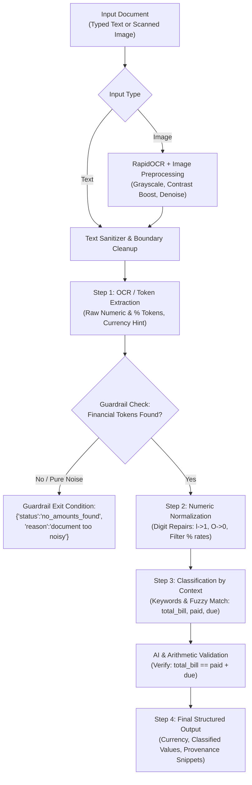

# AI-Powered Amount Detection in Medical Documents

> **Plum SDE Intern Assignment — Problem Statement 4**  
> **Focus Area:** OCR &rarr; Numeric Normalization &rarr; Context Classification &rarr; Final Structured Output with Provenance

[](https://www.python.org/downloads/)
[](https://fastapi.tiangolo.com)
[](https://github.com/RapidAI/RapidOCR)
[]()
[]()

---

## 📌 Problem Overview

Medical bills and pharmacy receipts are often typed, scanned, crumpled, or partially degraded. This project implements a production-grade backend service that extracts financial amounts from noisy medical documents and converts them into structured scheduling/billing JSON with provenance.

The system features:
1. **Step 1 - OCR / Text Extraction**: Extracts raw numeric and percentage tokens, detects currency hints (e.g., `INR`, `USD`), and flags noisy documents.
2. **Step 2 - Numeric Normalization**: Corrects OCR digit misrecognitions (e.g., `l200` &rarr; `1200`, `1OOO` &rarr; `1000`), removes rates/percentages (e.g. `10%`), and casts amounts to numeric numbers.
3. **Step 3 - Classification by Context**: Uses surrounding keywords and fuzzy Levenshtein matching to categorize amounts into `total_bill`, `paid`, `due`, `discount`, etc.
4. **Step 4 - Final Structured Output**: Emits structured JSON with currency, labeled amounts, and precise provenance (`"text: '...'"`).
5. **Guardrails & Error Handling**: Strict exit conditions when documents contain no amounts or exceed noise thresholds (`status: "no_amounts_found", reason: "document too noisy"`).
6. **AI Chaining & Validation**: Arithmetic balance verification (`total_bill == paid + due`) and optional Gemini AI multimodal auditing.
7. **Interactive Web Playground**: Built-in browser UI for drag-and-drop image uploads, live preset tests, and step-by-step visual tracing.

---

## 🏗️ Architecture & Pipeline Flow



---

## 🚀 Quickstart & Setup Instructions

### 1. Prerequisites
- Python 3.10+ (tested on Python 3.12)
- Git

### 2. Clone & Setup Virtual Environment
```bash
# Clone the repository
git clone <your-repo-url>
cd medical-amount-detector

# Create virtual environment
python -m venv venv

# Activate virtual environment
# Windows:
venv\Scripts\activate
# Linux/macOS:
source venv/bin/activate

# Install dependencies
pip install -r requirements.txt
```

### 3. Generate Sample Receipts
```bash
python scripts/generate_sample_images.py
```

### 4. Run the API Server
```bash
uvicorn app.main:app --reload --host 127.0.0.1 --port 8000
```
- **Web UI Playground:** [http://127.0.0.1:8000/](http://127.0.0.1:8000/)
- **Interactive Swagger Docs:** [http://127.0.0.1:8000/docs](http://127.0.0.1:8000/docs)
- **ReDoc:** [http://127.0.0.1:8000/redoc](http://127.0.0.1:8000/redoc)

---

## 🌐 Live Demo with ngrok (For Submission)

To expose your local backend server publicly with ngrok:
```bash
# 1. Start the backend server
uvicorn app.main:app --host 127.0.0.1 --port 8000

# 2. In another terminal, launch ngrok
ngrok http 8000
```
ngrok will provide a public URL like `https://xxxx-xx-xx.ngrok-free.app`. Anyone can open that URL in their browser to access the Web UI Playground or call the API endpoints directly!

---

## 🐳 Docker Deployment

You can build and run the entire service via Docker:
```bash
# Build Docker image
docker build -t medical-amount-detector .

# Run container
docker run -p 8000:8000 medical-amount-detector
```
Access [http://localhost:8000](http://localhost:8000).

---

## 🧪 Pipeline Steps & JSON Schema Specifications

### Step 1: OCR / Text Extraction
Extracts raw numeric tokens from bills/receipts.

- **Endpoint:** `POST /api/v1/step1-extract`
- **Sample Input (Text):**
  ```json
  {
    "text": "Total: INR 1200 | Paid: 1000 | Due: 200 | Discount: 10%"
  }
  ```
- **Expected Output (JSON):**
  ```json
  {
    "raw_tokens": ["1200", "1000", "200", "10%"],
    "currency_hint": "INR",
    "confidence": 0.85
  }
  ```
- **Guardrail / Exit Condition:**
  ```json
  {
    "status": "no_amounts_found",
    "reason": "document too noisy"
  }
  ```

---

### Step 2: Normalization
Repairs OCR digit misreads and maps to numeric quantities (stripping percentage rates).

- **Endpoint:** `POST /api/v1/step2-normalize`
- **Sample Input:**
  ```json
  {
    "raw_tokens": ["l200", "1OOO", "200", "10%"]
  }
  ```
- **Expected Output (JSON):**
  ```json
  {
    "normalized_amounts": [1200, 1000, 200],
    "normalization_confidence": 0.82
  }
  ```
*(Note: `l200` repaired to `1200`, `1OOO` repaired to `1000`, `10%` excluded as a rate).*

---

### Step 3: Classification by Context
Uses surrounding context to label amounts.

- **Endpoint:** `POST /api/v1/step3-classify`
- **Sample Input:**
  ```json
  {
    "normalized_amounts": [1200, 1000, 200],
    "context_text": "T0tal: Rs l200 | Pald: 1000 | Due: 200"
  }
  ```
- **Expected Output (JSON):**
  ```json
  {
    "amounts": [
      { "type": "total_bill", "value": 1200 },
      { "type": "paid", "value": 1000 },
      { "type": "due", "value": 200 }
    ],
    "confidence": 0.80
  }
  ```

---

### Step 4: Final Output (Structured JSON with Provenance)
Returns labeled amounts with currency and source provenance snippets.

- **Endpoint:** `POST /api/v1/process-text` or `POST /api/v1/process-image`
- **Sample Input (Text):**
  ```json
  {
    "text": "Total: INR 1200 | Paid: 1000 | Due: 200 | Discount: 10%"
  }
  ```
- **Expected Output (JSON):**
  ```json
  {
    "currency": "INR",
    "amounts": [
      { "type": "total_bill", "value": 1200, "source": "text: 'Total: INR 1200'" },
      { "type": "paid", "value": 1000, "source": "text: 'Paid: 1000'" },
      { "type": "due", "value": 200, "source": "text: 'Due: 200'" }
    ],
    "status": "ok"
  }
  ```

---

## 📡 Sample cURL Requests

### 1. Process Text Input
```bash
curl -X POST "http://127.0.0.1:8000/api/v1/process-text" \
  -H "Content-Type: application/json" \
  -d '{"text": "Total: INR 1200 | Paid: 1000 | Due: 200 | Discount: 10%"}'
```

### 2. Process Noisy OCR Text
```bash
curl -X POST "http://127.0.0.1:8000/api/v1/process-text" \
  -H "Content-Type: application/json" \
  -d '{"text": "T0tal: Rs l200 | Pald: 1000 | Due: 200"}'
```

### 3. Process Scanned Image Upload
```bash
curl -X POST "http://127.0.0.1:8000/api/v1/process-image" \
  -F "file=@app/samples/sample_noisy.png"
```

### 4. Trigger Guardrail (Non-financial document)
```bash
curl -X POST "http://127.0.0.1:8000/api/v1/process-text" \
  -H "Content-Type: application/json" \
  -d '{"text": "Clinical note: Patient has mild viral fever. Advised bed rest and hydration."}'
```
Response:
```json
{
  "status": "no_amounts_found",
  "reason": "document too noisy"
}
```

Ready-to-run scripts are also available in `scripts/curl_examples.sh` and `scripts/curl_examples.bat`.

---

## 📬 Postman Collection

Import `postman/Plum_Medical_Amount_Detection.postman_collection.json` into Postman to test all endpoints out of the box with pre-configured requests and schemas.

---

## 🧪 Automated Testing

The project includes 19 comprehensive unit and integration tests covering OCR ingestion, tokenization, digit correction, classification, provenance, and guardrails:

```bash
# Run test suite
python -m pytest -v
```

Expected output:
```
tests/test_api_endpoints.py::test_health_check PASSED
tests/test_api_endpoints.py::test_api_step1_extract PASSED
tests/test_api_endpoints.py::test_api_step2_normalize PASSED
tests/test_api_endpoints.py::test_api_step3_classify PASSED
tests/test_api_endpoints.py::test_api_process_text_full PASSED
tests/test_api_endpoints.py::test_api_process_image_clean PASSED
tests/test_api_endpoints.py::test_api_process_image_guardrail PASSED
tests/test_guardrails.py::test_guardrail_empty_text PASSED
tests/test_guardrails.py::test_guardrail_pure_noise PASSED
tests/test_guardrails.py::test_guardrail_prescription_without_amounts PASSED
tests/test_step1_extraction.py::test_step1_typed_text_sample PASSED
tests/test_step1_extraction.py::test_step1_noisy_ocr_sample PASSED
tests/test_step1_extraction.py::test_detect_currency PASSED
tests/test_step2_normalization.py::test_step2_assignment_sample PASSED
tests/test_step2_normalization.py::test_step2_ocr_digit_repairs PASSED
tests/test_step2_normalization.py::test_clean_and_repair_token PASSED
tests/test_step3_classification.py::test_step3_assignment_sample PASSED
tests/test_step3_classification.py::test_step3_noisy_ocr_context PASSED
tests/test_step4_final_output.py::test_step4_assignment_sample PASSED

============================= 19 passed in 6.65s ==============================
```

---

## 🖥️ Interactive Web UI & Terminal Demo

### 1. Terminal Demo
To see all sample scenarios executed in your console:
```bash
python scripts/run_demo.py
```

### 2. Browser UI Demo (Ideal for Screen Recording)
1. Start the server: `uvicorn app.main:app --reload`
2. Open [http://127.0.0.1:8000/](http://127.0.0.1:8000/) in your browser.
3. Test presets:
   - **Sample 1 (Assignment Text):** Standard typed receipt.
   - **Sample 2 (Noisy OCR Text):** Tests `T0tal`, `l200`, `Pald`.
   - **Sample 3 (Hospital Invoice):** Tests multi-line consultation, medicines, and bill amounts.
   - **Sample 4 (Guardrail Test):** Demonstrates guardrail trigger and error banner.
   - **Image Upload:** Upload receipt image or click "Noisy / Crumpled Sample" to see end-to-end OCR processing.
4. Observe the live execution cards for **Step 1**, **Step 2**, **Step 3**, and **Step 4** along with the **AI & Arithmetic Balance Validation** badge (`1200 == 1000 + 200`).

---

## 📁 Repository Structure

```
medical-amount-detector/
├── app/
│   ├── __init__.py
│   ├── main.py                     # FastAPI routes & static file mount
│   ├── config.py                   # App configuration & thresholds
│   ├── models/
│   │   ├── __init__.py
│   │   └── schemas.py              # Pydantic schemas for Steps 1-4 & Guardrails
│   ├── services/
│   │   ├── __init__.py
│   │   ├── ocr_service.py          # RapidOCR integration & image enhancement
│   │   ├── token_extractor.py      # Step 1: Raw tokens & currency hint
│   │   ├── digit_normalizer.py     # Step 2: OCR digit repair & parsing
│   │   ├── context_classifier.py   # Step 3: Contextual classification & fuzzy matching
│   │   ├── provenance_tracker.py   # Step 4: Final output & provenance tracking
│   │   ├── ai_validator.py         # AI & arithmetic balance validation
│   │   └── pipeline.py             # Pipeline orchestrator
│   ├── static/
│   │   ├── index.html              # Interactive Web UI playground
│   │   ├── app.js                  # Frontend client logic & step visualizer
│   │   └── style.css               # Clean responsive styling
│   └── samples/                    # Generated sample receipts (clean, noisy, empty)
├── tests/
│   ├── test_step1_extraction.py    # Step 1 unit tests
│   ├── test_step2_normalization.py # Step 2 unit tests
│   ├── test_step3_classification.py# Step 3 unit tests
│   ├── test_step4_final_output.py  # Step 4 unit tests
│   ├── test_guardrails.py          # Guardrails & exit condition tests
│   └── test_api_endpoints.py       # Full REST API integration tests
├── scripts/
│   ├── generate_sample_images.py   # Script to generate sample bill images
│   ├── run_demo.py                 # CLI demo runner
│   ├── curl_examples.sh            # Bash cURL test commands
│   └── curl_examples.bat           # Windows cURL test commands
├── postman/
│   └── Plum_Medical_Amount_Detection.postman_collection.json
├── Dockerfile                      # Containerization configuration
├── requirements.txt                # Python dependencies
├── pytest.ini                      # Pytest configuration
└── README.md                       # Documentation & submission guide
```

---

## 🛡️ Evaluation Criteria Checklist

| Criterion | Implementation in this Project | Status |
| :--- | :--- | :---: |
| **Correctness of API responses & JSON schemas** | Strictly matches Problem Statement 4 outputs for Steps 1, 2, 3, and 4 | ✅ Verified |
| **Handling of text & image inputs with OCR** | Supports both typed text and image upload using RapidOCR + image enhancements | ✅ Verified |
| **Guardrails & error handling** | Returns exact exit condition `{"status": "no_amounts_found", "reason": "document too noisy"}` | ✅ Verified |
| **Code organization & clarity** | Modular service-oriented architecture with typed Pydantic models and full docstrings | ✅ Verified |
| **Effective AI chaining & validation** | Validates arithmetic consistency (`total == paid + due`), fuzzy matching for OCR typos, and optional Gemini auditing | ✅ Verified |
| **Submission Deliverables** | Working demo UI, cURL scripts, Postman collection, Dockerfile, and complete setup guide | ✅ Verified |
